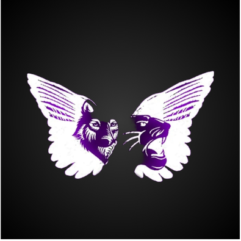
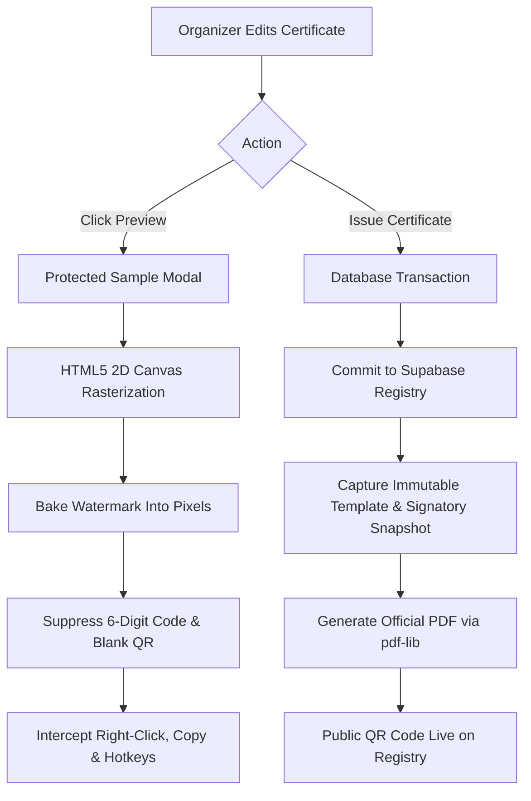

# 🎓 Namdapha Certificate Portal

<div align="center">



### Institutional Certificate Generation, Visual Canvas Studio & Verification Registry

[](https://reactjs.org/)
[](https://www.typescriptlang.org/)
[](https://vitejs.dev/)
[](https://tailwindcss.com/)
[](https://supabase.com/)
[](https://pdf-lib.js.org/)
[](https://nodejs.org/)
[](LICENSE)

<p align="center">
  A state-of-the-art credential issuance platform featuring an interactive visual studio, anti-copy protected previews, immutable snapshot registries, bulk issuance, and tamper-evident instant QR verification.
</p>

[Key Features](#-key-features) •
[Architecture](#-architecture--tech-stack) •
[Security & Protection](#-security--anti-copy-protection) •
[Quick Start](#-quick-start) •
[Database Migrations](#-database-migrations) •
[Automated Tests](#-test-suite)

</div>

---

## 🌟 Key Features

### 🎨 Visual Template Studio
- **Canva-Style Drag & Drop Canvas**: Place and align recipient names, event titles, achievement text, issue dates, dynamic QR codes, and multiple official signatory blocks.
- **Precision Typography & Layout**: Full control over font families (*Cinzel, Great Vibes, Playfair Display, Inter, Montserrat*), font sizes, weights, letter-spacing, text alignment, and custom hex color palettes.
- **A4 Dual-Orientation Support**: Seamless landscape and portrait geometry handling with automatic DPI resolution scaling.
- **Live Background Ingestion**: Upload custom certificate backgrounds (PNG/JPEG) directly to Supabase Storage with instant visual feedback.

### 🛡️ Protected Watermarked Sample Preview
- **High-DPI HTML5 Canvas Renderer**: Generates sample views on a secure raster canvas without exposing downloadable image tags (``) or triggering forced PDF downloads.
- **Tamper-Proof Watermark Shield**: Dual-layer defense baking visible diagonal watermarks directly into the 2D pixel buffer and layering a non-selectable SVG security pattern.
- **Active Code Suppression**: Withholds official 6-digit verification codes and replaces QR codes with placeholders during draft and sample modes.
- **Anti-Extraction Safeguards**: Intercepts context menus (right-click), blocks text selection (`user-select: none`), disables dragging, and captures keyboard print/save shortcuts (`Ctrl+S`, `Ctrl+P`).

### 📜 Authoritative Verification Registry
- **6-Digit Cryptographic Lookup**: Generates unique, human-friendly 6-digit verification codes with collision prevention and leading zero retention.
- **Instant QR Code Resolution**: Camera-scannable high-density QR codes pointing directly to public verification endpoints.
- **Immutable Snapshot Architecture**: Every issued certificate preserves a frozen snapshot of its template configuration, fonts, and signatories at the exact moment of issuance. Subsequent template modifications never alter historical certificates.
- **Public Credential Portal**: Clean, institutional interface for verifying credentials with authentic, revoked, or expired status indicators.

### ⚡ High-Throughput Bulk Issuance
- **PapaParse CSV Ingestion**: Fast client-side CSV parsing supporting UTF-8, quoted strings, comma-escaping, and error reporting.
- **Smart Description Generator**: Context-aware descriptions for fest events (Debate, Hackathon, Coding, Gaming, Cultural).
- **JSZip Multi-PDF Bundling**: Simultaneously generates individual vector PDFs and packages them into a single organized ZIP archive with sanitized filenames.
- **Real-Time Progress Tracking**: Step-by-step validation, issuance feedback, and batch operation summaries.

### 🔒 Enterprise Governance & Security
- **PostgreSQL Row Level Security (RLS)**: Fine-grained access control on tables (`certificates`, `templates`, `signatories`, `events`, `audit_logs`).
- **Private Storage Buckets**: Signatures and assets are secured behind authenticated storage policies.
- **Append-Only Audit Trail**: Immutable ledger tracking all certificate creations, template updates, and credential revocations.
- **Offline / Hybrid Mock API**: Full mock service layer allowing complete testing, demoing, and offline development with zero cloud dependencies.

---

## 🏗️ Architecture & Tech Stack

```
namdapha-certificate-portal/
├── public/                     # Static assets, backgrounds, logos, signatures
│   ├── certificates/           # Sample high-res certificate backgrounds
│   ├── logo/                   # Institutional brand identity
│   └── signatures/             # Authorized signatory vector assets
├── src/
│   ├── components/
│   │   ├── admin/              # Issue modals, protected preview modal, template cards
│   │   ├── layout/             # Admin sidebar, navigation shell, public layouts
│   │   └── ui/                 # Accessible buttons, badges, modals, inputs, tables
│   ├── pages/
│   │   ├── admin/              # Studio, Events, Certificates, Signatories, Audit
│   │   └── public/             # Verification portal, Minimal landing page
│   ├── services/
│   │   ├── apiInterface.ts     # Unified contract for Supabase & Mock implementations
│   │   ├── mockApiService.ts   # Offline-first in-memory data store with test parity
│   │   ├── pdfService.ts       # High-fidelity vector PDF generation (pdf-lib & qrcode)
│   │   └── supabaseService.ts  # Production PostgreSQL, RLS, Auth & Storage integration
│   ├── types/                  # Strict TypeScript definitions & schema types
│   └── utils/                  # Code generators, coordinate mappers, CSV helpers
├── supabase/
│   └── migrations/             # Version-controlled idempotent SQL migrations & RLS
└── tests/                      # Automated Node test runner suites (Phases 2 through 7)
```

| Layer | Technologies |
|---|---|
| **Core Framework** | [React 18](https://reactjs.org/) + [Vite 5](https://vitejs.dev/) + [TypeScript 5.5](https://www.typescriptlang.org/) |
| **Styling & Icons** | [Tailwind CSS 3.4](https://tailwindcss.com/) + [Lucide React](https://lucide.dev/) |
| **PDF & Graphics Engine** | [pdf-lib](https://pdf-lib.js.org/) + [qrcode](https://www.npmjs.com/package/qrcode) + HTML5 Canvas API |
| **Data & Storage** | [Supabase](https://supabase.com/) (PostgreSQL, Auth, Storage, Row Level Security) |
| **Batch Processing** | [PapaParse](https://www.papaparse.com/) + [JSZip](https://stuk.github.io/jszip/) |
| **Testing** | [Node.js Native Test Runner](https://nodejs.org/api/test.html) (`node --test`) |

---

## 🛡️ Security & Anti-Copy Protection

The platform enforces a multi-tier defense system for previewing and issuing certificates:



1. **No Unprotected Image URLs**: Sample views are rendered through JavaScript canvas calls rather than hotlinkable image URLs.
2. **Watermark Inseparability**: Watermarks are rasterized alongside certificate text inside the rendering loop, making separation impossible.
3. **Registry As Source Of Truth**: A certificate's validity depends on its record in the PostgreSQL registry, not on possessing a PDF document.

---

## 🚀 Quick Start

### Prerequisites
- [Node.js](https://nodejs.org/) v18.0.0 or higher
- [npm](https://www.npmjs.com/) v9.0.0 or higher

### 1. Clone & Install
```bash
git clone https://github.com/Techy-prashant/Certificate-Generator.git
cd Certificate-Generator
npm install
```

### 2. Environment Configuration
Create a `.env.local` file in the project root:
```env
# Supabase Configuration
VITE_SUPABASE_URL=https://your-project.supabase.co
VITE_SUPABASE_ANON_KEY=your-anon-key-here

# Optional: Set to 'true' to force offline mock mode without Supabase
VITE_USE_MOCK_API=false
```

*(If Supabase credentials are not provided, the application automatically falls back to the in-memory mock service so you can start developing immediately).*

### 3. Start Development Server
```bash
npm run dev
```
Open [http://localhost:5173](http://localhost:5173) in your browser.

---

## 🗄️ Database Migrations

Database tables and Row Level Security policies are managed via version-controlled SQL scripts:

```bash
# Migration files located in:
supabase/migrations/
├── 20261011000001_initial_schema.sql         # Core tables, constraints & triggers
├── 20261011000002_row_level_security.sql     # RLS policies & role permissions
└── 20261011000003_storage_buckets.sql        # Storage buckets & access controls
```

To run migrations on your Supabase instance:
```bash
npx supabase db push
```

---

## 🧪 Test Suite

The project includes an end-to-end automated verification suite covering every milestone:

```bash
# Run all automated tests
npm test

# Type-check with TypeScript
npm run lint

# Production build verification
npm run build
```

### Verification Coverage:
- **Phase 2**: Database schema constraints, RLS policies, seed consistency.
- **Phase 3**: Admin workflows, event lifecycle, signatory order, and Canva asset handling.
- **Phase 4**: Template studio coordinates, A4 dimensions, word wrapping, and dynamic QR synthesis.
- **Phase 5**: 6-digit collision resistance, snapshot immutability, public verification rate limiting.
- **Phase 6**: PapaParse CSV ingestion, JSZip batch packaging, audit logs, and Cloudflare Pages headers.
- **Phase 7**: Protected sample preview engine, anti-copy hooks, watermark rasterization, and code suppression.

---

## 📜 Available Scripts

| Command | Description |
|---|---|
| `npm run dev` | Starts the Vite development server with HMR |
| `npm run build` | Compiles TypeScript and builds production distribution in `dist/` |
| `npm run preview` | Previews the production build locally |
| `npm run lint` | Runs `tsc --noEmit` to verify type safety |
| `npm test` | Runs the 39-test automated test suite via Node test runner |

---

## 👥 Authors & Acknowledgments

- **Developed by**: [Techy-prashant](https://github.com/Techy-prashant)
- **Institution**: Namdapha Fest & Academic Directorate
- **Design Inspiration**: Modern Minimalist Design System (Midnight Violet `#191724`, Warm Ivory `#F7F5F0`, Amethyst `#7760B5`)

---

## 📄 License

This project is licensed under the MIT License — see the [LICENSE](LICENSE) file for details.
